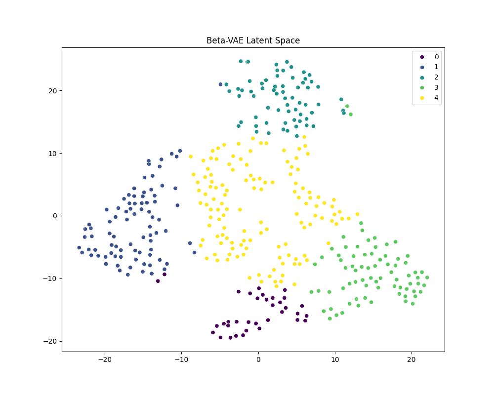
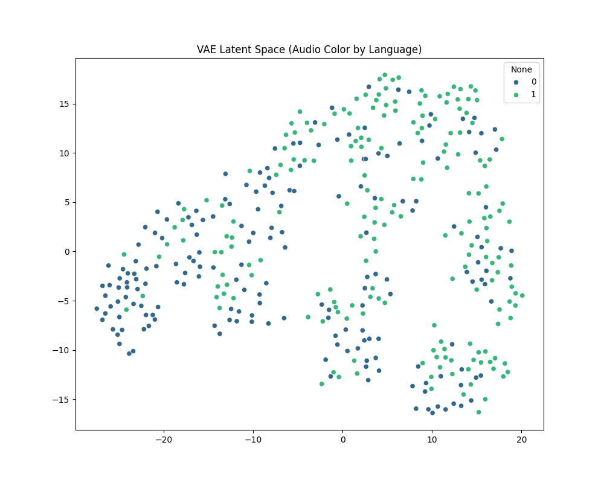

# Multi-Modal Music Clustering with VAEs

Clustering Bangla and English songs from their **audio** and **lyrics** with variational autoencoders, and testing whether learned latent spaces group music better than classical methods do.

Course project for CSE425 Neural Networks, BRAC University, Fall 2025.

## The problem

Music libraries need to group songs by how they sound and what they're about, often without labels. Two things make this hard for a mixed Bangla and English collection:

- **Raw features are noisy and high-dimensional.** MFCCs, spectrograms and word counts carry a lot of information that has nothing to do with musical similarity.
- **Audio and lyrics describe different things.** A song's sound and its words can point in different directions, and the lyrics are in two languages.

The question: can a VAE compress each song into a small latent space where clusters are cleaner than with standard dimensionality reduction, and does adding lyrics to audio help?

## Dataset

A collection of **450 songs** with lyrics (250 Bangla, 200 English), labeled with artist, genre and language. Audio was downloaded and cut to 30-second clips; **about 390 songs** had usable audio and were used for the audio and multimodal experiments.

- `data/lyrics/hybrid_songs.csv`: song, artist, genre, lyrics and language
- `data/audio/downloader.py`, `data/audio/clip_audio.py`: scripts to fetch and clip the audio (the audio files are not stored in the repo)

## Approach

The project runs in three stages of increasing difficulty.

1. **Audio only.**
   - **Features:** 30 per song, from MFCC means and standard deviations, spectral centroid, and zero-crossing rate.
   - **Model:** a basic VAE with an 8-dimensional latent space, clustered with K-Means (k = 5).
   - **Baseline:** PCA followed by K-Means.
2. **Spectrograms and audio plus lyrics.**
   - **Spectrograms:** a convolutional VAE on mel-spectrograms.
   - **Audio plus lyrics:** a hybrid VAE that encodes MFCC features and TF-IDF lyric vectors into one 16-dimensional latent space. Its latent space is clustered with K-Means, agglomerative clustering and DBSCAN.
3. **Disentangled multimodal representation.**
   - **Model:** a Beta-VAE (β = 4) on fused audio, lyric and one-hot genre features.
   - **Comparison:** a plain autoencoder and spectral clustering.

**Evaluation:**

- **Cluster quality:** Silhouette, Calinski-Harabasz and Davies-Bouldin scores.
- **Agreement with known labels:** ARI, NMI and purity against each song's language.

## Results

**Stage 1: audio only**

| Method | Silhouette ↑ | Calinski-Harabasz ↑ |
|---|---|---|
| PCA + K-Means (baseline) | 0.17 | 89.2 |
| **VAE + K-Means** | **0.39** | **322.8** |

**Stage 2: spectrograms and audio plus lyrics**

| Method | Silhouette ↑ | Calinski-Harabasz ↑ | Davies-Bouldin ↓ |
|---|---|---|---|
| Conv VAE (spectrograms) + K-Means | 0.14 | 50.8 | 1.81 |
| **Hybrid VAE + K-Means** | **0.21** | **96.8** | **1.46** |
| Hybrid VAE + Agglomerative | 0.18 | 78.2 | 1.57 |
| Hybrid VAE + DBSCAN | −0.29 | 3.2 | 1.87 |

**Stage 3: audio, lyrics and genre**

| Method | Silhouette ↑ | Davies-Bouldin ↓ | NMI ↑ | Purity ↑ |
|---|---|---|---|---|
| **Beta-VAE + K-Means** | **0.36** | **0.87** | **0.12** | **0.72** |
| Autoencoder + K-Means | 0.11 | 2.08 | 0.10 | 0.67 |
| Spectral clustering | 0.10 | 2.11 | 0.10 | 0.66 |

| Beta-VAE latent space (5 clusters) | Audio VAE latent space, coloured by language |
|---|---|
|  |  |

## What I found

- **VAE latent spaces gave much cleaner clusters than classical reduction.** On audio alone, the VAE more than doubled the silhouette score of PCA (0.39 vs 0.17) and nearly quadrupled the Calinski-Harabasz score.
- **The Beta-VAE was the strongest multimodal model.** On fused audio, lyrics and genre it beat both a plain autoencoder and spectral clustering on every metric. The extra pressure toward a disentangled latent space produced tighter, better-separated clusters.
- **Adding lyrics to audio helped**: the hybrid VAE clustered better than the spectrogram-only convolutional VAE. K-Means suited its latent space best, while DBSCAN failed to find meaningful density-based clusters.
- **The clusters are not language clusters.** NMI against language stayed low (about 0.12), and the language-coloured plot shows Bangla and English songs mixed throughout the audio latent space. The models group songs by acoustic and lyrical similarity rather than by language, which is what you want from a music-similarity model.


## Running it

```bash
pip install -r requirements.txt
```

Download and clip the audio into `data/audio/bangla` and `data/audio/english` with the scripts in `data/audio/`, then run each stage from the project root:

```bash
python src/runners/run_easy.py
python src/runners/run_medium.py
python src/runners/run_hard.py
```

Metrics are written to `results/<stage>/` as CSV files, along with the cluster plots.

## Project structure

```
data/           lyrics CSVs and audio download scripts
src/models/     VAE, convolutional VAE, hybrid VAE, Beta-VAE, autoencoder
src/runners/    one script per stage
results/        metrics and plots for each stage
```
